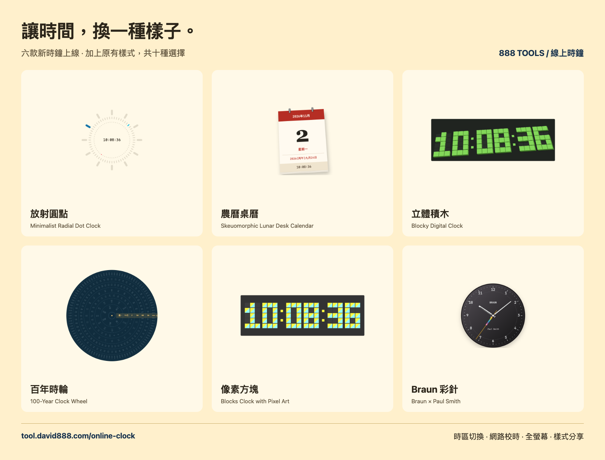

# 讓時間，換一種樣子。

888tools 線上時鐘新增六款樣式。把桌面變成農曆紙張桌曆、讓秒數沿著圓點刻度前進，或用立體積木與像素方塊顯示現在時間。

## 這次帶來什麼？

- **放射圓點**：三層刻度分別顯示時、分、秒，中間保留數位時間。
- **農曆桌曆**：紅色紙張日曆配上農曆、星期和即時時間。
- **立體積木**：綠色積木隨著數字變化升降。
- **百年時輪**：年、月、日、星期與時間各自排列成輪，當下數值在右側交會。
- **像素方塊**：黃、青色的像素數字，帶一點復古遊戲感。
- **Braun 彩針**：深色錶盤搭配彩色秒針。

加上原有數位、類比、翻頁與中文字，共十種樣式。每款都能切換時區與全螢幕，適合工作桌面、客廳螢幕或單純欣賞時間。右下角常駐的版本標籤也已移除。

**[立即體驗 → tool.david888.com/online-clock](https://tool.david888.com/online-clock?mode=radial)**

[完整操作指南與設計來源](../../src/tools/online-clock/online-clock-guide.md) · [更新紀錄](../../CHANGELOG.md)

## 可直接分享的短文

> 讓時間，換一種樣子。888tools 線上時鐘新增放射圓點、農曆桌曆、立體積木、百年時輪、像素方塊與 Braun 彩針，現在共有十種樣式。選好時區、打開全螢幕，讓桌面有自己的時間風格。
>
> 立即試用：https://tool.david888.com/online-clock
>
> #888tools #線上時鐘 #桌面時鐘 #農曆 #像素風

分享圖：[下載六款時鐘總覽 PNG](../screenshots/online-clock/overview.png)。圖片由實際功能截圖組成。
