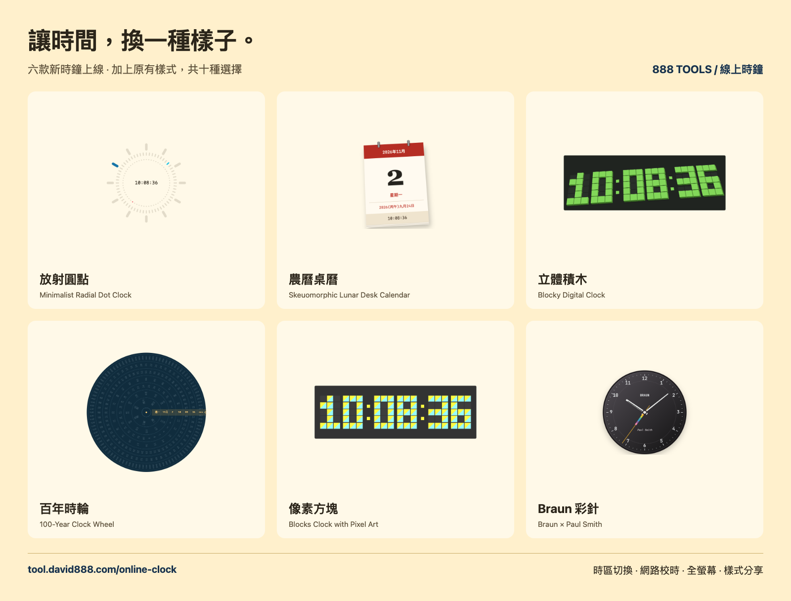

# 線上時鐘 / Online clock

十種時鐘樣式共用時區、12／24 小時、秒數與網路校時設定。選擇樣式後會記住偏好；網址的 `mode` 參數可直接開啟與分享指定樣式。日期與農曆均依所選時區計算。

## 操作方式

1. 開啟[線上時鐘](https://tool.david888.com/online-clock)，點選時鐘下方的樣式名稱。
2. 使用上方時區選單或下方城市按鈕切換地區。
3. 使用「24h」「顯示秒」「顯示日期」「網路校時」調整顯示。關閉網路校時後使用裝置時間。
4. 點選「全螢幕」放大；移動滑鼠、觸碰螢幕或按鍵可叫出控制列，按 Escape 或返回鍵離開。
5. 複製網址即可分享所選樣式；其他顯示偏好保留於自己的瀏覽器。

## 六款新增樣式與截圖

| 樣式 | 畫面特色 | 截圖 |
| --- | --- | --- |
| [放射圓點](https://tool.david888.com/online-clock?mode=radial) | 三層刻度以藍、青、紅分別標示時、分、秒 | [實際畫面](../../../docs/screenshots/online-clock/radial.png) |
| [農曆桌曆](https://tool.david888.com/online-clock?mode=lunar) | 紅色日曆、金屬裝訂環、紙張堆疊與農曆日期 | [實際畫面](../../../docs/screenshots/online-clock/lunar.png) |
| [立體積木](https://tool.david888.com/online-clock?mode=blocky) | 綠色立體方塊隨數字變化升降 | [實際畫面](../../../docs/screenshots/online-clock/blocky.png) |
| [百年時輪](https://tool.david888.com/online-clock?mode=wheel) | 年、秒、分、時、日、月、星期同心輪盤，右側高亮目前數值 | [實際畫面](../../../docs/screenshots/online-clock/wheel.png) |
| [像素方塊](https://tool.david888.com/online-clock?mode=pixel) | 黃與青兩色的 3×5 像素數字 | [實際畫面](../../../docs/screenshots/online-clock/pixel.png) |
| [Braun 彩針](https://tool.david888.com/online-clock?mode=braun) | 深色圓形錶盤、白色指針與彩色秒針 | [實際畫面](../../../docs/screenshots/online-clock/braun.png) |

原有樣式網址：`?mode=digital`、`?mode=analog`、`?mode=flip`、`?mode=chinese`。

## 實作與設計來源

The online clock offers ten styles. The six additional styles are original Vue, SVG and CSS implementations inspired by the following demos in [FreeFrontend's JavaScript clocks collection](https://freefrontend.com/javascript-clocks/):

| URL `mode` | Design reference | Author |
| --- | --- | --- |
| `radial` | [Minimalist Radial Dot Clock](https://codepen.io/cbolson/pen/dPGWzQX) | Chris Bolson |
| `lunar` | [Skeuomorphic Lunar Desk Calendar](https://codepen.io/ericadu/pen/GRZJjjE) | Erica |
| `blocky` | [Blocky Digital Clock](https://codepen.io/jkantner/pen/KQaZdp) | Jon Kantner |
| `wheel` | [100-Year Clock Wheel](https://codepen.io/cbolson/pen/azoVvZm) | Chris Bolson |
| `pixel` | [Blocks Clock with Pixel Art Digits](https://codepen.io/elalemanyo/pen/abOpovL) | elalemanyo |
| `braun` | [CSS Clock (Braun × Paul Smith)](https://codepen.io/paulnoble/pen/gbPGMZZ) | Paul Noble |

All styles use the parent's selected timezone and network-adjusted time. Calendar dates use the selected timezone, including native `Intl` Chinese calendar conversion. The wheel shows the current century's 100 years and the actual number of days in the selected month. Seconds and calendar data follow the visibility controls. The 3D block animation respects reduced-motion preferences.

Examples: `/online-clock?mode=radial`, `/online-clock?mode=wheel`.
